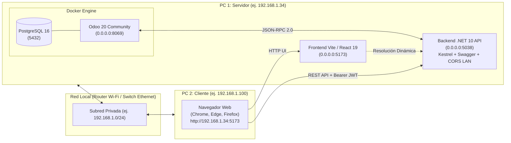

# Guía de Despliegue y Pruebas en Red Local (LAN) entre Dos Computadoras

Esta guía detalla el procedimiento para desplegar y verificar el sistema Punto de Venta (POS) operando de manera distribuida entre dos equipos en una misma red de área local (Wi-Fi o Ethernet), manteniendo al 100% la compatibilidad con el entorno de desarrollo local (`localhost`).

---

## 1. Arquitectura de Red y Topología

En esta topología, la **PC 1 (Servidor)** hospeda todos los servicios del sistema, y la **PC 2 (Cliente)** accede mediante su navegador web sin necesidad de tener instalado .NET, Node.js ni Docker.



---

## 2. Checklist Previo al Despliegue

Antes de iniciar los servicios, verifique los siguientes requisitos en ambos equipos:

- [ ] **Misma subred de red local**: Ambos equipos deben estar conectados al mismo enrutador Wi-Fi o switch Ethernet (ej. `192.168.1.x`).
- [ ] **Perfil de Red en Windows**: En la PC 1 (Servidor), la red debe estar configurada como **Red Privada** (Configuración > Red e Internet > Propiedades > Red privada) para permitir tráfico entrante controlado.
- [ ] **Sin Aislamiento de Clientes (AP Isolation)**: Verifique que el router no tenga activa la opción *AP Isolation* o *Client Isolation*, la cual impide la comunicación directa entre dispositivos de la red Wi-Fi.
- [ ] **Conectividad básica ICMP**: Desde la PC 2, ejecute en terminal `ping <IP_DEL_SERVIDOR>` para confirmar conectividad de capa 3.

---

## 3. Configuración del Firewall en la PC Servidor

Para que la PC Cliente pueda alcanzar los puertos de la API y el Frontend, abra los puertos TCP `5038` y `5173` en el Firewall de Windows de la PC Servidor.

### Opción A: Mediante PowerShell (como Administrador)
```powershell
New-NetFirewallRule -DisplayName "POS-Backend-5038" -Direction Inbound -LocalPort 5038 -Protocol TCP -Action Allow -Profile Any
New-NetFirewallRule -DisplayName "POS-Frontend-5173" -Direction Inbound -LocalPort 5173 -Protocol TCP -Action Allow -Profile Any
```

### Opción B: Mediante CMD / netsh (como Administrador)
```cmd
netsh advfirewall firewall add rule name="POS-Backend-5038" dir=in action=allow protocol=TCP localport=5038
netsh advfirewall firewall add rule name="POS-Frontend-5173" dir=in action=allow protocol=TCP localport=5173
```

> [!NOTE]
> Si en el futuro desea retirar estas reglas temporales:
> `Remove-NetFirewallRule -DisplayName "POS-Backend-5038", "POS-Frontend-5173"`

---

## 4. Paso a Paso para el Arranque en la PC Servidor

### Paso 1: Detección de la IP de la PC Servidor
Ejecute el script multiplataforma provisto:
```bash
py -3 scripts/detect_lan_ip.py
```
*Salida esperada:*
```text
Direccion IP detectada en LAN: 192.168.1.34
```
*(Anote esta dirección IP, por ejemplo `192.168.1.34`, para usarla en la PC Cliente).*

### Paso 2: Iniciar Odoo y PostgreSQL
```bash
docker compose -f infra/docker-compose.yml up -d
```
Verifique que los contenedores estén activos:
```bash
docker compose -f infra/docker-compose.yml ps
```

### Paso 3: Iniciar el Backend .NET 10 (Escuchando en 0.0.0.0)
El backend está configurado en Kestrel para enlazar a `http://0.0.0.0:5038`, permitiendo conexiones simultáneas desde `localhost` y desde la IP LAN:
```bash
dotnet run --project backend/src/Pos.Api
```
*Salida esperada:*
```text
info: Microsoft.Hosting.Lifetime[14]
      Now listening on: http://0.0.0.0:5038
```

> [!TIP]
> Si desea permitir orígenes específicos adicionales mediante variables de entorno, puede definir:
> `$env:CORS_ALLOWED_ORIGINS="http://192.168.1.100:5173"` antes de ejecutar `dotnet run`. Por defecto, la política CORS ya admite de manera dinámica cualquier IP privada local (RFC 1918: `192.168.x.x`, `10.x.x.x`, `172.16-31.x.x`).

### Paso 4: Iniciar el Frontend Vite (Escuchando en 0.0.0.0)
En una segunda terminal en la PC Servidor:
```bash
npm --prefix frontend run dev
```
*Salida esperada:*
```text
  VITE v8.3.5  ready in 250 ms

  ➜  Local:   http://localhost:5173/
  ➜  Network: http://192.168.1.34:5173/
```

---

## 5. Acceso y Pruebas desde la PC Cliente (Segunda Computadora)

En la PC Cliente, abra cualquier navegador web moderno (Chrome, Edge, Firefox, Safari):

### 1. Acceso a la Interfaz del Punto de Venta (POS)
Navegue a:
```text
http://<IP_DEL_SERVIDOR>:5173
```
*(Ejemplo: `http://192.168.1.34:5173`)*

**¿Cómo funciona la resolución dinámica?**
El frontend (`frontend/src/infrastructure/apiUrl.js`) examina `window.location.hostname`. Al detectar que el usuario navega desde `192.168.1.34`, dirige automáticamente todas las llamadas de la API a `http://192.168.1.34:5038` sin requerir que modifique ningún archivo de configuración.

### 2. Acceso a la Documentación Swagger UI
Navegue a:
```text
http://<IP_DEL_SERVIDOR>:5038/swagger
```
- Podrá interactuar con todos los endpoints `v1` y alias compatibles.
- Para probar endpoints protegidos, use el botón **Authorize** e ingrese el token JWT obtenido en `/api/v1/auth/login`.

### 3. Pruebas de Roles de Usuario
- **Rol Cajero**: Ingrese credenciales de cajero configuradas (ej. `cajero1` / `cajero123`). Compruebe que puede buscar productos, cotizar ventas y registrar cobros.
- **Rol Administrador**: Ingrese credenciales de administrador (ej. `admin` / `admin123`). Compruebe el acceso a la pestaña exclusiva de **Reportes Consolidados** (`/api/v1/reports/sales`).

---

## 6. Verificación Automatizada de Red y CORS

El proyecto incluye el script [verify_lan.py](file:///d:/PATRONES DE SOTFWARE/ProyectoPatrones/scripts/verify_lan.py) para auditar la conectividad sin requerir intervención manual:

### Ejecución de la Verificación
Desde la PC Servidor o desde la PC Cliente (teniendo Python 3):
```bash
py -3 scripts/verify_lan.py --server-ip 192.168.1.34 --client-ip 192.168.1.100
```

### Reporte de Evidencia Generado
El script genera automáticamente el archivo de auditoría [lan_verification_report.json](file:///d:/PATRONES DE SOTFWARE/ProyectoPatrones/docs/evidencias/lan_verification_report.json) con los siguientes puntos de control:

| Punto de Control | Tipo | Puerto/Ruta | Criterio de Aprobación |
| :--- | :--- | :--- | :--- |
| **Backend API** | TCP Socket | `5038` | Conexión TCP establecida en $< 100$ ms |
| **Frontend UI** | TCP Socket | `5173` | Conexión TCP establecida en $< 100$ ms |
| **Odoo POS** | TCP Socket | `8069` | Conexión TCP establecida |
| **OpenAPI Spec** | HTTP GET | `/openapi/v1.json` | Status HTTP 200, JSON válido con OpenAPI 3.x |
| **Versionamiento** | HTTP GET | `/api/v1/discounts` | Cabeceras `X-Api-Version: 1.0` y `api-supported-versions: 1.0` |
| **CORS Preflight** | HTTP OPTIONS | `/api/v1/auth/login` | Status 200/204 con `Access-Control-Allow-Origin: http://<CLIENT_IP>:5173` |
| **Frontend HTML** | HTTP GET | `/` | Status HTTP 200, documento HTML servido por Vite |

---

## 7. Resolución de Incidencias Comunes (Troubleshooting)

### Error `ERR_CONNECTION_TIMED_OUT` en PC Cliente
- **Causa**: El Firewall de Windows en la PC Servidor está descartando los paquetes entrantes.
- **Solución**: Ejecute el comando de regla de firewall del paso 3 en la PC Servidor y verifique que la red esté como "Red Privada".

### Error `ERR_CONNECTION_REFUSED` en PC Cliente
- **Causa**: El servicio (Backend o Frontend) no se encuentra en ejecución o está escuchando únicamente en `127.0.0.1` en lugar de `0.0.0.0`.
- **Solución**: Compruebe en la PC Servidor mediante `netstat -ano | findstr 5038` que la dirección local figure como `0.0.0.0:5038` y no `127.0.0.1:5038`.

### Error `CORS Policy: No 'Access-Control-Allow-Origin' header`
- **Causa**: El origen de la PC Cliente no fue reconocido en las políticas de CORS.
- **Solución**: La configuración actual en `Program.cs` admite automáticamente cualquier IP local privada (`192.168.*`, `10.*`, `172.16-31.*`). Si utiliza una subred o VPN personalizada, inicie el backend con:
  `$env:CORS_ALLOWED_ORIGINS="http://<IP_CLIENTE>:5173"; dotnet run --project backend/src/Pos.Api`

### Error `No route to host` / Imposible hacer Ping
- **Causa**: Aislamiento de punto de acceso (AP Isolation) habilitado en el router Wi-Fi corporativo/doméstico.
- **Solución**: Conecte ambos equipos mediante cable Ethernet al mismo switch o comparta conexión Wi-Fi desde una de las PCs (Zona con cobertura móvil / Hotspot de Windows).
